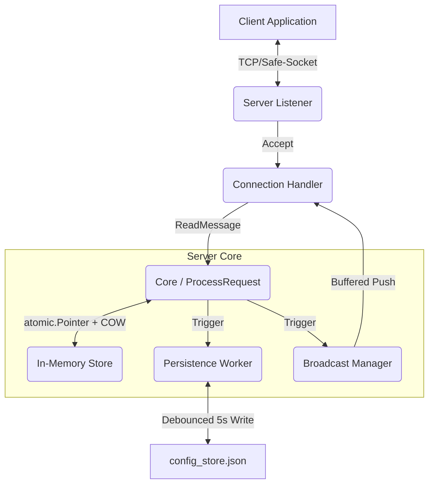

# Config Server Architecture

This document provides a technical deep-dive into the architecture of the `config-server` project.

## High-Level Overview

The Config Server is designed as a centralized, high-performance configuration management system. Its primary goals are:
- **Atomicity**: Configuration updates are atomic (Copy-On-Write) to prevent partial reads or half-migrated states.
- **Real-Time Distribution**: Updates are pushed to connected clients immediately via non-blocking mailboxes.
- **Reliability**: Uses a robust framed TCP protocol with handshake verification and instance-aware identity management.

## Component Architecture

### 1. Network Layer (`safe-socket`)
The server delegates low-level networking to the **[safe-socket](https://github.com/Bastien-Antigravity/safe-socket)** library.
- **Profile**: `tcp-hello`
- **Shadow Port Protocol**: In accordance with platform standards, gRPC services are exposed on the **Shadow Port** (Base Port + 1).
  - TCP Management Port: `3306`
  - gRPC Sync Port: `3307`
- **Features**: 
...
  - **Handshake**: Enforces an identity exchange (Name/Group) immediately after connection.
  - **Framing**: Handled via `ReadMessage()`, ensuring complete protocol frames are processed.
  - **Resource Management**: Implements a 10-minute `IdleTimeout` to prune zombie connections.
  - **Reconnection**: Handled by the client-side of the library.

### 2. Server Logic (`src/server`)
- **Lifecycle**: `Server.Start()` initializes the listener (`atomic.Pointer[factory.Socket]`) and starts the 1-second background `persistenceWorker` (which re-marks state dirty on save failure for automatic retry on the next tick).
- **Broadcast System**: Uses a lock-free `atomic.Pointer[map[string]*clientMailbox]` listener table and a **Lifecycle-Safe Per-Client Mailbox Pattern** (buffer: 3 messages, paired with a `done chan struct{}` closed via `sync.Once`). `Broadcast()` and `broadcastRegistry()` dereference the immutable listener map directly with zero mutex acquisition, sorting `active_services` and `service_addresses` deterministically via `sort.Strings` and selecting on `<-mailbox.done` so disconnected clients are skipped without ever closing `mailbox.send`. Outgoing writes are handled in dedicated goroutines to prevent slow clients from blocking the server. If a client mailbox transiently overflows, the server sets a `needsRefresh` flag and elevates the next delivery to a complete `FULL_REFRESH` snapshot, gracefully resynchronizing the client without disruptive socket teardowns or peer reconnect storms.
- **Identity Management**: Uses stable `Service-IP` identification. `addListener` and `removeListener` serialize map Copy-On-Write updates via `writeMu` and use pointer comparison to protect against "ghost disconnections" during rapid service restarts.

### 3. Core Logic (`src/core`)
- **Request Processing**: `ProcessRequest` acts as the dispatcher. It deserializes `ConfigMsg` (Protobuf) and interacts with the Store, supporting `GET_SYNC`, `PUT_SYNC`, `DELETE_SYNC`, and `FULL_REFRESH`.
- **Lean Deletions**: Deletions can be executed either via dedicated `DELETE_SYNC` or by passing a `"__DELETED__"` sentinel in standard `PUT_SYNC` delta payloads. Detecting a deletion automatically triggers a `FULL_REFRESH` broadcast so clients purge removed keys.
- **Ultra-Fast Persistence & Ordering**: In-memory updates acknowledge in sub-millisecond time and mark state as `dirty`, flushed by the 1-second background worker. Responses carry monotonic revision numbers (`ConfigMsg.Version`) for client sequence gap detection.

### 4. Storage Layer (`src/store`)
- **Data Structure**: `ConfigMap` (`map[string]map[string]string`) held in an `atomic.Pointer[ConfigMap]`, paired with an atomic `version atomic.Uint64` revision counter.
- **Concurrency & Path-Copying COW**:
  - Uses `atomic.Pointer[ConfigMap]` for 100% lock-free reads and `sync.Mutex` (`writeMu`) to serialize Copy-On-Write mutations.
  - **Path-Copying Granular Mutations**: `store.UpdateSection()` clones only the specific section map being modified, structurally sharing all other untouched sections across versions to minimize memory allocations.
  - **Granular ApplyUpdates**: Delta merges clone only sections present in the delta payload, retaining shared pointers for all untouched sections.
- **Persistence**: Debounced 1-second atomic worker flushes dirty state via `pm.Save()`, while synchronous save (`SaveSync()`) is invoked on graceful shutdown via `toolbox_lifecycle.Manager`.

### 5. Unified Controller Interface (`src/core/controller.go`)
To prevent package cycles and maintain protocol-agnostic business logic, all management actions are defined inside the `core.ConfigController` interface:
- **`GetConfig` / `SetConfig` / `DeleteConfig`**: Interface methods for atomic value updates and deletions.
- **`ListConfig`**: Returns a merged configuration map of active overrides and static base YAML settings (e.g., `common`, `capabilities`).
- **`ReloadConfig` / `PersistConfig` / `GetStatus`**: Unified hooks for reloading, saving, and auditing runtime health.
This interface is implemented directly by the main `server.Server` struct.

### 6. Decoupled Delivery Adapters
The management interfaces are designed as pluggable, decoupled adapters depending strictly on the `core.ConfigController` interface:
- **gRPC Adapter (`src/grpc_control`)**: Implements `ConfigControlServiceServer`, translating protobuf requests to controller method calls.
- **REST Adapter (`src/rest`)**: Exposes JSON endpoints under `/api/v1/config/` for external dashboards (e.g., the Web Interface).
- **Telegram / Tele-Remote (`src/telegram`)**: Encapsulates dynamic menu orchestration (`MenuManager`) and connection handshakes, keeping `main.go` completely free of presentation logic.

## Data Flow

### Configuration Update Flow
1. **Client** sends `PUT_SYNC` message with new section/key/value pairs.
2. **Server** receives payload via `ReadMessage()` and passes it to `core.ProcessRequest`.
3. **Core** applies updates to a **sandbox copy** of the current configuration.
4. **Store** commits the new version if the update function succeeds.
5. **Persistence** marks the state as `dirty`. The background worker performs an atomic write to `config_store.json` on the next ticker cycle (5s).
6. **Broadcaster** constructs a `BROADCAST_SYNC` message and pushes it into each client's mailbox.

### Client Handshake & Auto-Discovery Flow
1. **Client** connects using SafeSocket (with `auto-hello`, `tcp-hello`, or `tls-hello`).
2. **Safe-Socket** executes the handshake exchange (`HelloMsg`).
3. **Server** validates identity (`FromName`) and captures the advertised inbound service address (`FromAddress`).
4. **Server** registers a new `clientMailbox` containing `name` and `serviceAddress`.
5. **Server** dispatches `BROADCAST_REGISTRY` containing both active services and dynamic service addresses (`service_addresses: ["name=address"]`).
6. **Server** enters the `ReadMessage()` loop.

## Dependencies

- **distributed-config**: Provides the `ConfigMsg` Protobuf definitions and configuration schemas.
- **safe-socket**: Handles TCP transport, framing, and strict connection validity.
- **universal-logger**: Provides centralized, structured logging for all layers.
